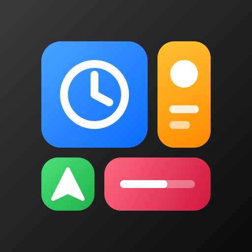

# Dashboard

A multi-widget home screen for the car: a big clock, weather, a mini player,
navigation status, speed, the car itself, and messages from other CarPWA
apps. It shows how far a CarPWA app can go with plain HTML, CSS and ES
modules: no build step, no CDN, nothing that needs the car to be online
except the weather.



| | |
|---|---|
| id | `com.carpwa.example.dashboard` |
| permissions | `media`, `media.control`, `navigation`, `location`, `network` |
| network.allow | `api.open-meteo.com` |

## Layout

One CSS grid on six tracks, rearranged with `grid-template-areas`:

| screen | layout |
|---|---|
| 800×480, 1280×720 | two columns; speed, car and messages share the bottom row |
| 1920×720 (`min-aspect-ratio: 2/1`) | three columns; tall clock and player |
| `html[data-carpwa-limited]` (driving) | weather, car and messages hide (`.cp-hide-when-limited` from `carpwa.css`); clock, player, navigation and speed grow |

Sizes follow the viewport with `clamp()` and `vh`, not container queries,
because CarPWA supports iOS 15. Nothing scrolls, and every widget keeps its
content inside its box. That matters for the knob: `focus.set()` scrolls the
focused element into view, which would shift an overflowing widget.

## Widgets

| file | shows | APIs |
|---|---|---|
| `widgets/clock.js` | time and date in the phone's locale, redrawn on the minute | `ui.on('foreground')` |
| `widgets/weather.js` | Open-Meteo current weather: car location if available, otherwise the default city; the last reading is cached for offline starts | `net.fetch`, `storage`, `location` (via `lib/location.js`) |
| `widgets/media.js` | artwork, title, artist, play/pause | `media.getNowPlaying/getArtwork/togglePlayPause`, `media.on(...)` |
| `widgets/nav.js` | "Navigating with Maps" or idle; app names from `apps.list()` | `nav.getState`, `nav.on('change')`, `apps.list` |
| `widgets/speed.js` | GPS speed in km/h or mph; the unit button saves the choice | `location.watch` (via `lib/location.js`), `storage` |
| `widgets/car.js` | car name, day or night mode | `car.getInfo`, `car.on('state')` |
| `widgets/channel.js` | latest message on `carpwa.examples`; heartbeat every 30 s, *Wave* button | `channel().publish/subscribe` |

`lib/settings.js` keeps units and the default city in `CarPWA.storage` and
follows `storage.onChange`, so another page of the app (or the simulator's
storage inspector) can change them live. `lib/location.js` runs one location
feed for both weather and speed. It calls `getCurrent()` first because
`watch()` is an event subscription whose failures, such as `EPERM`, only reach
the console.

## Settings and the knob

The sliders button opens a sheet (units, default city). While it is open:

- the board gets `data-carpwa-nofocus`, so the knob stays inside the sheet;
- `input.on('back')` makes the car's back button close the sheet instead of
  leaving the app. Closing turns interception off again with
  `input.interceptBack(false)`.

When the car starts limiting the UI and the focused widget disappears, the
`car.on('state')` handler moves focus to the next visible control. The SDK has
already updated `data-carpwa-limited` before `car` state listeners run.

## Failing calmly

Each widget explains its own problem in one short line and keeps working:
*Not on CarPlay* (`ENOTCAR`), *Location not allowed* (`EPERM`), *Offline* and
the age of the last reading (`EUNAVAILABLE`), and so on. Storage, channels and
`net.fetch` need carpwad. In a plain web server the SDK would queue those calls
for 15 seconds, so `lib/util.js` checks `CarPWA.env.server` and fails fast.

## Run it

```sh
carpwa sim examples/dashboard --open
carpwa sim examples/dashboard --screen 1920x720
carpwa sim examples/dashboard --input knob
```

In the simulator, start playback, start a route, and turn on *driving* (it
also limits the UI) to see the widgets react. Publish to the
`carpwa.examples` channel from the simulator's channel panel to see the
message widget update.
